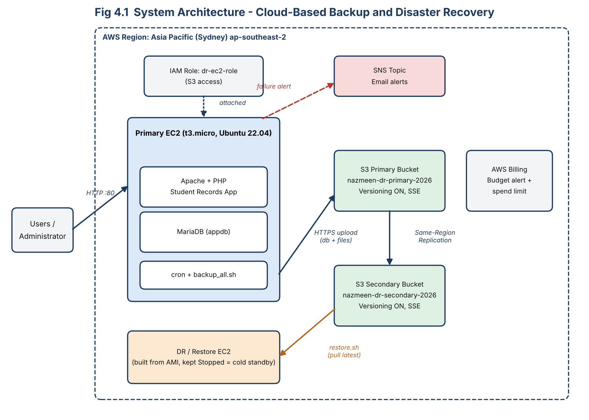

# Cloud-Based Disaster Recovery and Backup System

MCA Semester III project, GLA University, Mathura  
Author: **Nazmeen Ali**

A small, low-cost backup and disaster recovery (DR) system built on AWS. A web
application (Apache, PHP, MariaDB) on an EC2 server is backed up every 30 minutes
to a versioned, encrypted S3 bucket. S3 Same-Region Replication copies every
backup to a second bucket. A DR server in a different Availability Zone is kept
stopped and is started only during a disaster; one script restores the latest
backup. A failed backup sends an e-mail through Amazon SNS.

## Architecture



| Part | Resource |
|---|---|
| Primary server | EC2 t3.micro, Ubuntu 22.04, AZ ap-southeast-2b |
| DR server | EC2 t3.micro from an AMI, AZ ap-southeast-2c (normally stopped) |
| Backups | S3 primary bucket (versioning, encryption) |
| Replica | S3 secondary bucket (Same-Region Replication) |
| Alerts | SNS topic with e-mail subscription |
| Access | IAM role attached to the servers (no access keys) |

More diagrams: [backup flow](diagrams/fig_4_2_backup_flow.png),
[failover flow](diagrams/fig_4_3_failover_flow.png),
[RPO/RTO timeline](diagrams/fig_6_1_rpo_rto.png).

## Repository structure

```
scripts/   backup_all.sh, restore.sh
config/    dr_backup.cron
app/       index.php, schema.sql
diagrams/  architecture and flow diagrams
docs/      screenshots
report/    full project report (Word)
```

## Setup (summary)

1. Launch an Ubuntu 22.04 EC2 instance and install the stack:
   `sudo apt install -y apache2 mariadb-server php libapache2-mod-php php-mysql`
2. Load the sample database: edit the password in `app/schema.sql`, then
   `sudo mysql < app/schema.sql`. Copy `app/index.php` to `/var/www/html/` and
   set the same password in it.
3. Create two S3 buckets with versioning and encryption, and a replication rule
   from the primary to the secondary bucket.
4. Create an IAM role for EC2 with S3 and SNS access and attach it to the servers.
5. Create an SNS topic and confirm an e-mail subscription.
6. Copy `scripts/*.sh` to `/usr/local/bin/`, set the placeholders (bucket names,
   SNS ARN, password) and run `chmod +x`.
7. Install the cron file: `sudo cp config/dr_backup.cron /etc/cron.d/dr_backup`.
8. Create an AMI of the server and launch the DR server from it in another
   Availability Zone with the same IAM role; stop it.

## Failover

1. Start the DR server and connect.
2. Run `sudo /usr/local/bin/restore.sh`.
3. Open `http://<DR public IP>` and check the data.

## Results (failover drill 1)

| Item | Value |
|---|---|
| Last backup (T0) | 2026-11-24 07:04:29 UTC |
| Time until DR server ready | 3 min 24 s |
| restore.sh finished | 4 min 41 s after failure |
| **RTO (application back)** | **6 min 10 s** |
| RPO | bounded by the 30-minute backup interval |

The record added after the last backup was not recovered; the record included in
the backup was restored.

## Limitations

- The AWS account was limited to one region, so the replica bucket and the DR
  server are in the same region (different Availability Zone). A whole-region
  outage is not covered.
- RPO equals the backup interval (30 minutes).
- Demo IAM policies are broad (S3 and SNS full access); use least privilege in
  real systems.

## Future work

Cross-region replication, point-in-time recovery, S3 Object Lock, automated
failover with DNS health checks, infrastructure as code, a status dashboard.

## Security note

Do not commit passwords, `.pem` key files, AWS access keys, account IDs or
screenshots that show them.

## License

MIT
